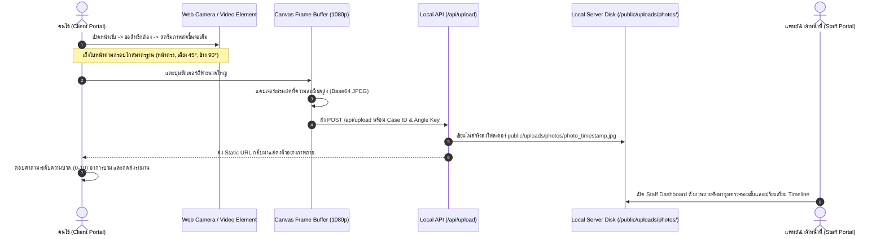

# แผนผังระบบและสรุปการปรับปรุงระบบ UD Clinic — Post-Operative Face-Lift Monitoring (ฉบับใช้งานจริง คลีน 100%)

> วันที่: 11 ตุลาคม 2026  
> สถานะ: ระบบปรับปรุงเป็น Clean State 100% พร้อมใช้งานจริงทั้งฝั่ง Client และ Staff บน Local Environment (`http://localhost:3000`)

---

## 1. แจกแจงรายการข้อมูลจำลอง (Mock-up) ทั้งหมดที่ถูกลบออกเรียบร้อยแล้ว

ก่อนหน้านี้ในระบบตัวอย่าง มีการสร้างข้อมูลจำลองเพื่อสาธิตฟังก์ชันต่างๆ ซึ่งปัจจุบัน **ได้ทำการลบออกทั้งหมดอย่างหมดจด (Purged Clean 100%)** ประกอบด้วย:

| ลำดับ | รายการที่เคยจำลอง (Mock-up) | รายละเอียดที่ลบทิ้ง | สถานะปัจจุบันในระบบ |
|---|---|---|---|
| 1 | **รายชื่อและข้อมูลคนไข้จำลอง** | ลบชื่อ คุณวรรณา ศิริพร (HN-2026-0891, 58 ปี), คุณกมลพร จันทร์กระจ่าง (HN-2026-0884, 62 ปี), คุณวิมลมัส ธนสารสุข (HN-2026-0872, 65 ปี) | `INITIAL_PATIENTS = []` (ไม่มีรายชื่อค้าง) |
| 2 | **เคสผ่าตัดจำลอง** | ลบเคส Full Face-Lift, SMAS Plication, Neck Lift จำลองทั้งหมด | `INITIAL_CASES = []` (ไม่มีเคสค้าง) |
| 3 | **คิวรอตรวจและประวัติรายงานประจำวัน** | ลบรายงาน D+1, D+2, D+4 จำลอง พร้อมสถานะ Needs Doctor Review / Needs Urgent Attention | `INITIAL_REPORTS = []` (ตารางคิวว่างเปล่า คลีน 100%) |
| 4 | **ภาพวาดโครงหน้าและรอยช้ำจำลอง (SVG Faces)** | ลบรูป SVG วาดหน้าการ์ตูนจำลอง และรูป Placeholder ทั้งหมด | ระบบรองรับเฉพาะ **ภาพถ่ายจริงจากกล้อง/ไฟล์จริง** เท่านั้น |
| 5 | **ข้อความประเมินและ Internal Notes จำลอง** | ลบความเห็นจำลองของ พว.สุดา และ นพ.เอกสิทธิ์ ออกทั้งหมด | กล่องข้อความว่างเปล่า รอให้ทีมแพทย์/เจ้าหน้าที่พิมพ์จริง |
| 6 | **Audit Trail จำลอง** | ลบประวัติ Log จำลองการคลิกดูเคสย้อนหลังทั้งหมด | `INITIAL_AUDIT_LOGS = []` เริ่มบันทึกเฉพาะการกระทำจริง |

---

## 2. โซลูชันระบบ Login สำหรับคนไข้สูงวัย (Elderly-Friendly Frictionless Login)

### ความเข้าใจในธรรมชาติของคนไข้ดึงหน้า (Face-Lift Demographics)
- **กลุ่มเป้าหมาย:** สุภาพสตรีและสุภาพบุรุษอายุ **50 - 75 ปี**
- **อุปสรรคสำคัญ:** 
  1. จำชื่อผู้ใช้ (Username) และรหัสผ่าน (Password) ไม่ได้
  2. สับสนกับการขอรหัส OTP ทาง SMS ทุกเช้า
  3. สายตายาว อ่านตัวหนังสือขนาดเล็กหรือพิมพ์แบบฟอร์มซับซ้อนลำบาก
  4. มักติดต่อสื่อสารกับคลินิกผ่าน **LINE OA** อยู่แล้วในชีวิตประจำวัน

### สถาปัตยกรรม Login 2 รูปแบบที่พัฒนาใช้งานจริง:

```mermaid
flowchart TD
    subgraph FlowA["ทางเลือกที่ 1: Magic Link ผ่าน LINE OA (แนะนำและง่ายที่สุด)"]
        StaffReg["เจ้าหน้าที่ลงทะเบียนเคสใน Staff Portal"] --> CopyLink["กดปุ่ม 'คัดลอกลิงก์ส่งให้คนไข้ใน LINE'"]
        CopyLink --> SendLine["ส่งลิงก์ให้คนไข้ในแชท LINE (เช่น ?token=CASE-TOKEN-XXXX)"]
        SendLine --> PatientClick["คนไข้แตะลิงก์ในแชท LINE ครั้งเดียว"]
        PatientClick --> AutoOpen["ระบบอ่าน Token -> เปิดหน้าจอกล้องใหญ่กลางจอทันที! (ไม่ต้องพิมพ์อะไรเลย)"]
    end

    subgraph FlowB["ทางเลือกที่ 2: กรอกเบอร์มือถือ 10 หลัก (กรณีเข้าผ่าน Browser ปกติ)"]
        DirectOpen["คนไข้เปิดเว็บคลินิกโดยไม่มี Token"] --> BigInput["หน้าจอคลีน แสดงช่องตัวเลขขนาดใหญ่พิเศษ"]
        BigInput --> EnterPhone["กรอกเบอร์โทรศัพท์ 10 หลัก (เช่น 0812345678)"]
        EnterPhone --> PermanentStore["บันทึก Token จำเครื่องลงมือถือถาวร (Permanent Device Remember)"]
        PermanentStore --> DayNext["วันถัดไป (D+2, D+3, D+7) เปิดเว็บมาเจอกล้องทันที ไม่ต้องล็อกอินซ้ำ"]
    end
```



1. **LINE OA Magic Link (Zero Typing):**
   - คนไข้แค่แตะลิงก์ที่คลินิกส่งให้ทางแชท LINE ระบบจะตรวจจับ Token ประจำตัวเคสและพุ่งตรงเข้าสู่หน้ากล้องถ่ายรูปทันที 100% โดยไม่ต้องพิมพ์ตัวอักษรหรือรหัสผ่านใดๆ
2. **One-Time Phone Entry + Permanent Device Remember:**
   - หากเปิดลิงก์เปล่า หน้าจอจะแสดงเฉพาะช่องกรอก **เบอร์โทรศัพท์ 10 หลัก** ด้วยฟอนต์ขนาดใหญ่พิเศษ
   - เมื่อยืนยันเบอร์โทรสำเร็จ ระบบจะจำรหัสประจำตัวเคสลงใน Local Storage ของอุปกรณ์นั้นแบบถาวร ทำให้ในวันถัดๆ ไป (D+2, D+3, D+7) คนไข้ไม่ต้องกรอกใหม่อีกเลย

---

## 3. สถาปัตยกรรมระบบกล้องจริงและการจัดเก็บภาพ (Real Camera & Storage Architecture)



### รายละเอียดทางเทคนิค:
1. **WebRTC Camera Integration (`navigator.mediaDevices.getUserMedia`):**
   - กล้องเปิดทันทีเมื่อเข้าสู่หน้า Portal โดยตั้งค่าเป็นกล้องหน้า (`facingMode: 'user'`) และมีปุ่มสลับกล้องหลังได้
   - แสดงเส้นกรอบ Silhouette Alignment Guide บางๆ ซ้อนทับบนภาพสด เพื่อให้คนไข้เล็งมุมหน้าตรง, เฉียง 45°, และข้าง 90° ได้ถูกตำแหน่ง
2. **ระบบสำรอง (Upload Real File):**
   - มีปุ่มเลือกไฟล์รูปจากคลังภาพหรือกดถ่ายด้วยแอพกล้องของมือถือ สำหรับอุปกรณ์ที่ไม่รองรับ WebRTC
3. **API บันทึกไฟล์ลง Disk จริง (`/api/upload`):**
   - สร้างโฟลเดอร์ `public/uploads/photos/` อัตโนมัติบนเครื่องเซิร์ฟเวอร์
   - ถอดรหัส Base64 Buffer และเขียนไฟล์เป็น `.jpg` คุณภาพสูง
   - คืนค่า Static URL เช่น `/uploads/photos/photo_1791727...jpg` เพื่อให้หน้าเว็บและหน้า Staff Portal สามารถเรียกแสดงผล ซูมดูรอยแผล และนำไปเปรียบเทียบ Side-by-Side Timeline ได้อย่างคมชัด

---

## 4. โครงสร้าง 2 หน้าหลัก (Clean Two-Portal Architecture)

ระบบถูกออกแบบให้มีเพียง **2 หน้าหลัก** ตามที่สั่งการ:

```
┌────────────────────────────────────────────────────────────────────────┐
│                              UD CLINIC WEB APP                         │
├───────────────────────────────────┬────────────────────────────────────┤
│       1. หน้าคนไข้ (Client Portal)     │    2. หน้าเจ้าหน้าที่ & แพทย์ (Staff Portal)│
├───────────────────────────────────┼────────────────────────────────────┤
│ - ไม่มีตัวหนังสือเกะกะ                 │ - แดชบอร์ดสรุปเคสที่รอตรวจจริง           │
│ - กล้องถ่ายรูปเป็นจุดศูนย์กลางใหญ่เต็มจอ │ - ตารางคัดกรองรายงานรายวัน (Triage Queue)│
│ - บันทึกภาพ 5 มุมมาตรฐาน             │ - ระบบลงทะเบียนคนไข้ใหม่ + สร้าง Magic Link │
│ - แบบสอบถามอาการปวด/บวม แบบแตะเลือก   │ - หน้าต่างตรวจเคสแยก Internal vs Customer │
│ - ปุ่มโทรสายด่วนฉุกเฉินเด่นชัด          │ - แถบเปรียบเทียบภาพก่อน-หลังผ่าตัด (Timeline)│
└───────────────────────────────────┴────────────────────────────────────┘
```

---

## 5. วิธีการทดสอบใช้งานจริงแบบ End-to-End บนเครื่อง

1. เข้าเว็บที่ `http://localhost:3000`
2. **สลับไปหน้า "เจ้าหน้าที่ & แพทย์ (Staff)"** ผ่านแถบด้านบน
3. กดปุ่ม **"+ ลงทะเบียนคนไข้ใหม่"**
   - กรอกชื่อคนไข้ (เช่น คุณสมศรี เจริญสุข)
   - กรอกเลข HN (เช่น HN-69001)
   - กรอกเบอร์โทรศัพท์มือถือ 10 หลัก (เช่น `0891234567`)
   - เลือกหัตถการ (เช่น ดึงหน้าช่วงล่าง + ดึงคอ)
   - เลือกแพทย์เจ้าของไข้
   - กด **"ลงทะเบียนและสร้างเคส"**
4. ระบบจะแสดงกล่องแจ้งเตือนพร้อมปุ่ม **"คัดลอกลิงก์ส่งให้คนไข้ใน LINE"** (ซึ่งมี Token ประจำตัว)
5. **สลับไปหน้า "คนไข้ (Client)"**:
   - หน้าจอจะเปิดกล้องขึ้นมากลางจอทันที!
   - หรือหากทดสอบด้วยเบอร์โทรศัพท์ ให้กรอกเบอร์ `0891234567` แล้วกดยืนยัน
   - ถ่ายภาพให้ครบตามมุมที่กำหนด แตะตอบคะแนนความปวด แล้วกดยืนยันส่งรายงาน
6. **กลับมาที่หน้า Staff**:
   - จะเห็นรายงานของ คุณสมศรี ปรากฏในคิวรอตรวจทันที พร้อมรูปถ่ายจริงที่เซฟลงโฟลเดอร์ `public/uploads/photos/`
   - สามารถคลิกตรวจเคส พิมพ์บันทึกภายใน และส่งคำแนะนำกลับให้คนไข้ได้อย่างสมบูรณ์แบบ
