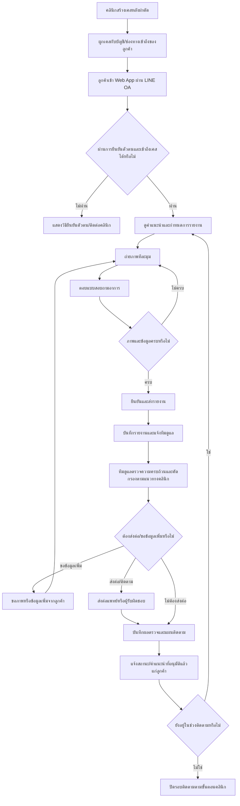

# UD Clinic — Post-Operative Face-Lift Monitoring Web App

> Product brief / PRD สำหรับใช้กับ Vibe Coding tools  
> เวอร์ชัน: 1.0  
> ภาษา UI: ภาษาไทย  
> ประเภทระบบ: Mobile-first Web App + Staff Dashboard  
> จุดเริ่มต้นของลูกค้า: LINE OA ของ UD Clinic  
> ขอบเขตแรก: ลูกค้าที่เข้ารับบริการผ่าตัดดึงหน้า (Face-lift) และการติดตามหลังผ่าตัด

---

## 1. Product Concept

สร้าง Web App สำหรับติดตามอาการและการฟื้นตัวของลูกค้าหลังผ่าตัดดึงหน้าที่ UD Clinic โดยลูกค้าจะเข้าใช้งานจากเมนูหรือ Rich Menu ใน LINE OA แล้วถ่ายภาพใบหน้าตามมุมที่ระบบแนะนำ พร้อมตอบคำถามเกี่ยวกับอาการประจำวัน ข้อมูลและภาพจะถูกส่งเข้า Dashboard ส่วนกลางเพื่อให้แพทย์หรือบุคลากรที่คลินิกมอบหมายตรวจสอบ ติดตาม และบันทึกผล

ระบบนี้ **ไม่ใช่ระบบวินิจฉัยโรคอัตโนมัติ** และไม่ใช่ช่องทางฉุกเฉิน จุดประสงค์หลักคือช่วยรวบรวมข้อมูลให้เป็นมาตรฐาน เปรียบเทียบภาพย้อนหลัง จัดคิวติดตาม และลดการพึ่งพาการส่งรูปในแชท LINE

### Product Vision

ทำให้การดูแลหลังผ่าตัดมีความต่อเนื่อง เป็นระบบ ตรวจสอบย้อนหลังได้ และใช้งานง่ายสำหรับทั้งลูกค้าและทีมดูแล

### Core Value

- **ลูกค้า:** รู้ว่าต้องรายงานอะไร ถ่ายรูปอย่างไร และรายงานของตนส่งถึงทีมดูแลแล้วหรือยัง
- **ทีมดูแล:** เห็นรายงานและภาพย้อนหลังในที่เดียว จัดลำดับงานและติดตามเคสที่ยังไม่เสร็จได้
- **แพทย์:** มีข้อมูลที่จัดรูปแบบสม่ำเสมอเพื่อใช้ประกอบการประเมินตามวิชาชีพ
- **คลินิก:** มีประวัติการส่งรายงาน การตรวจ และการติดตามที่ตรวจสอบย้อนหลังได้

---

## 2. Goals และ Success Metrics

### Goals

1. ให้ลูกค้าส่งรายงานประจำวันผ่าน Web App แทนการแนบภาพไว้ในแชท LINE
2. ช่วยให้ลูกค้าถ่ายภาพมุมเดิมและคุณภาพใกล้เคียงกันในแต่ละครั้ง
3. ให้ทีมดูแลเห็นรายงานใหม่และเคสที่ยังไม่ได้ตรวจอย่างชัดเจน
4. เก็บประวัติรายงานและผลตรวจไว้ใต้เคสหลังผ่าตัดแต่ละเคส
5. ลดความเสี่ยงจากการตกหล่น โดยแสดงสถานะ เจ้าของเคส และเวลาที่ต้องติดตาม
6. ปกป้องข้อมูลสุขภาพและภาพใบหน้าด้วยสิทธิ์เข้าถึงที่เหมาะสม

### Suggested Metrics

- อัตราการส่งรายงานตามกำหนด
- เวลาเฉลี่ยตั้งแต่ส่งรายงานจนมีผู้ตรวจรับผิดชอบ
- จำนวนรายงานที่ค้างตรวจเกิน SLA ที่คลินิกกำหนด
- สัดส่วนรายงานที่ต้องขอภาพหรือข้อมูลเพิ่ม
- อัตราลูกค้าที่ทำขั้นตอนรายงานสำเร็จโดยไม่ต้องให้เจ้าหน้าที่ช่วย

> ค่าเป้าหมายของตัวชี้วัดและเวลา SLA ให้คลินิกกำหนดหลังตกลงกระบวนการปฏิบัติงานจริง ห้ามกำหนดว่าเป็นมาตรฐานทางการแพทย์โดยอัตโนมัติ

---

## 3. Product Principles

1. **Mobile-first สำหรับลูกค้า:** ทุกขั้นตอนต้องใช้งานได้สะดวกบนมือถือ โดยเฉพาะเมื่อเปิดจาก LINE
2. **Guided capture:** ระบบนำลูกค้าถ่ายทีละมุม พร้อมตัวอย่างและคำแนะนำ ไม่ให้ลูกค้าต้องเดาเอง
3. **Clinician-defined protocol:** มุมภาพ คำถาม ระยะเวลารายงาน และเกณฑ์เร่งด่วนต้องตั้งค่า/ทบทวนโดยคลินิก
4. **Human review:** ห้ามให้ AI หรือกฎอัตโนมัติสรุปว่าลูกค้าปกติหรือวินิจฉัยภาวะแทรกซ้อน
5. **Clear status:** ลูกค้าต้องเห็นว่ารายงานส่งสำเร็จแล้ว แต่ห้ามแสดงข้อความที่ทำให้เข้าใจว่ามีผู้ตรวจแล้ว หากยังไม่มีผู้ตรวจ
6. **Privacy by design:** ภาพใบหน้าและประวัติหลังผ่าตัดต้องเป็นข้อมูลส่วนตัว ปิดการเข้าถึงสาธารณะเป็นค่าเริ่มต้น
7. **Auditability:** การตรวจ การแก้ไขสถานะ และการเปิดดูข้อมูลสำคัญของเจ้าหน้าที่ต้องตรวจสอบย้อนหลังได้ตามความเหมาะสม
8. **No emergency dependency:** หน้าแอปต้องแจ้งชัดว่าไม่ใช่ช่องทางฉุกเฉิน และไม่ควรรอคำตอบในระบบเมื่อมีอาการรุนแรง

---

## 4. User Roles และ Permissions

### 4.1 Patient / ลูกค้า

ทำได้:
- เข้าดูเคสหลังผ่าตัดของตัวเอง
- ดูวันที่หลังผ่าตัดและกำหนดการรายงาน
- เริ่มและส่งรายงานประจำวัน
- ถ่ายภาพตามมุมที่ระบบแสดง
- ตอบคำถามอาการและเขียนหมายเหตุ
- ดูสถานะและคำแนะนำที่ทีมดูแลส่งกลับมา
- ดูประวัติรายงานของตัวเองตามสิทธิ์ที่คลินิกกำหนด

ทำไม่ได้:
- ดูข้อมูลหรือภาพของลูกค้าคนอื่น
- แก้ไขรายงานที่ส่งแล้วโดยไม่ผ่านขั้นตอนเพิ่มเติม
- เข้าถึงบันทึกภายในของทีมดูแล

### 4.2 Care Staff / ผู้ช่วยหรือผู้ประสานงานดูแล

ทำได้ตามสิทธิ์ที่คลินิกกำหนด:
- ดูรายการเคสและรายงานที่ได้รับมอบหมาย
- ตรวจความครบถ้วนของภาพและคำตอบ
- ระบุว่าต้องขอภาพ/ข้อมูลเพิ่ม
- บันทึกหมายเหตุภายใน
- ส่งต่อเคสให้แพทย์หรือผู้รับผิดชอบที่มีอำนาจเหมาะสม
- ติดต่อกลับลูกค้าผ่านช่องทางที่คลินิกอนุมัติ

ข้อจำกัด:
- ไม่ควรมีสิทธิ์วินิจฉัยหรือปิดเคสทางการแพทย์ เว้นแต่บทบาทและขอบเขตวิชาชีพอนุญาตตามนโยบายคลินิก

### 4.3 Doctor / แพทย์

ทำได้:
- เปิดดูรายงาน ภาพย้อนหลัง และข้อมูลอาการของเคสที่ได้รับสิทธิ์
- บันทึกผลตรวจและแผนติดตาม
- กำหนดให้ขอข้อมูลเพิ่ม นัดหมาย หรือติดต่อกลับ
- ทำเครื่องหมายว่าต้องติดตามเร่งด่วนตามกระบวนการของคลินิก
- ระบุหรืออนุมัติโปรโตคอลแบบรายงานและมุมภาพ

### 4.4 Admin / ผู้ดูแลระบบคลินิก

ทำได้:
- จัดการบัญชีเจ้าหน้าที่และบทบาท
- เพิ่ม/แก้ไขข้อมูลลูกค้าและเคสตามนโยบาย
- กำหนดโปรโตคอลการรายงาน ตารางเวลา และข้อความแจ้งเตือน
- ดูสถานะภาพรวมและ Audit Log ตามสิทธิ์
- ตั้งค่าวันเริ่มหลังผ่าตัด วันสิ้นสุดการติดตาม และผู้รับผิดชอบ

> Admin ไม่ควรได้รับสิทธิ์เปิดภาพสุขภาพทุกเคสโดยอัตโนมัติ หากหน้าที่ไม่จำเป็นต้องใช้ภาพจริง ให้แยกสิทธิ์ดูข้อมูลทั่วไปกับสิทธิ์ดูภาพ

---

## 5. Scope: MVP vs Later

### MVP — ต้องมีในเวอร์ชันแรก

- หน้าลูกค้าแบบ responsive/mobile-first
- การเข้าถึงที่ปลอดภัยและผูกกับลูกค้า/เคสที่ถูกต้อง
- หน้าแนะนำและยืนยันการรับทราบ Privacy Notice/Consent ที่คลินิกอนุมัติ
- Guided photo capture ด้วยกล้องมือถือ
- ชุดมุมภาพที่ปรับได้ตามโปรโตคอลของคลินิก
- แบบรายงานอาการประจำวัน
- Preview ภาพก่อนส่ง และถ่ายใหม่ได้
- หน้ายืนยันส่งรายงาน พร้อมเวลาและเลขอ้างอิง
- Staff Dashboard แสดงรายงานใหม่/ค้างตรวจ/ต้องติดตาม/เสร็จแล้ว
- หน้ารายละเอียดเคสพร้อมภาพและรายงานย้อนหลัง
- การบันทึกผลตรวจ ผู้ตรวจ เวลา สถานะ และหมายเหตุ
- การขอข้อมูลหรือภาพเพิ่ม
- การแจ้งเตือนภายใน Dashboard
- การเตือนลูกค้าวันที่ควรรายงาน หรือรายงานที่ยังไม่ส่ง (ถ้าเชื่อมระบบแจ้งเตือนได้)
- สิทธิ์ตามบทบาทและประวัติการทำรายการสำคัญ
- หน้าเตือนอาการเร่งด่วนและระบุว่าแอปไม่ใช่ช่องทางฉุกเฉิน

### Later / ยังไม่ต้องทำใน MVP

- AI วิเคราะห์ภาพหรือให้คะแนนความปกติ
- Face recognition เพื่อยืนยันตัวตน
- Video consultation ในตัวระบบ
- เชื่อมระบบเวชระเบียน/HIS เต็มรูปแบบ
- Analytics ขั้นสูงและรายงานสถิติหลายสาขา
- การสร้าง PDF สรุปเวชระเบียนโดยอัตโนมัติ
- แอป iOS/Android แบบ native
- ระบบชำระเงิน

---

## 6. High-level Workflow



### Workflow Rules

- การส่งรายงานสำเร็จต้องแยกจากสถานะตรวจแล้วอย่างชัดเจน
- รายงานใหม่ต้องเข้าสู่คิวของทีมดูแลพร้อม timestamp
- หากรายงานถูกระบุว่าต้องติดตามเร่งด่วน ต้องมีขั้นตอนมอบหมายผู้รับผิดชอบและบันทึกการติดต่อกลับ
- การปิดรอบติดตามต้องเกิดจากผู้ใช้ที่ได้รับสิทธิ์ ไม่ใช่ปิดโดยอัตโนมัติเพียงเพราะครบจำนวนวัน
- การเปลี่ยนสถานะสำคัญต้องเก็บผู้ทำรายการและเวลาไว้

---

## 7. Patient User Flow

### Flow A: เข้าระบบครั้งแรก

1. ลูกค้ากดปุ่ม **ติดตามอาการหลังดึงหน้า** ใน LINE OA
2. เปิด Web App บนเบราว์เซอร์มือถือ
3. ยืนยันตัวตนด้วยวิธีที่คลินิกเลือก เช่น OTP หรือ secure invite link ที่หมดอายุได้
4. ระบบแสดงข้อมูลเคสที่ผูกกับลูกค้า โดยไม่เปิดให้ค้นหาผู้ป่วยจากชื่อสาธารณะ
5. ลูกค้าอ่าน Privacy Notice และยืนยันตามขั้นตอนที่คลินิกอนุมัติ
6. ระบบแสดงหน้า Overview: วันที่หลังผ่าตัด กำหนดรายงาน สถานะล่าสุด และปุ่ม **เริ่มรายงานวันนี้**

### Flow B: ส่งรายงานประจำวัน

1. กด **เริ่มรายงานวันนี้**
2. แสดงข้อควรทราบและข้อมูลว่าการส่งรายงานไม่ทดแทนการติดต่อฉุกเฉิน
3. ระบบแสดงรายการมุมภาพที่ต้องถ่ายตามโปรโตคอลของวันนั้น
4. เปิดกล้องทีละมุม พร้อม overlay/กรอบช่วยจัดตำแหน่งและตัวอย่างภาพ
5. ลูกค้าถ่ายภาพ ตรวจ preview และถ่ายใหม่ได้
6. ทำซ้ำจนภาพที่ต้องการครบทุกมุม
7. ตอบคำถามอาการประจำวัน
8. เพิ่มหมายเหตุหรือแนบรายละเอียดเพิ่มเติมได้ (optional)
9. ตรวจทานภาพและคำตอบทั้งหมด
10. กด **ส่งรายงาน** และยืนยัน
11. แสดงหน้าสำเร็จพร้อมเวลาส่งและข้อความ **ส่งรายงานแล้ว — รอทีมดูแลตรวจสอบ**
12. เมื่อทีมดูแลบันทึกผลแล้ว ระบบจะแสดงสถานะล่าสุดและข้อความที่อนุมัติให้ลูกค้าเห็น

### Flow C: ต้องส่งภาพ/ข้อมูลเพิ่ม

1. ลูกค้าได้รับการแจ้งเตือนว่าทีมดูแลต้องการภาพหรือข้อมูลเพิ่มเติม
2. เปิดรายงานเดิมและเห็นรายการที่ต้องส่งเพิ่มอย่างชัดเจน
3. ถ่ายภาพหรือกรอกข้อมูลเพิ่ม
4. ส่งกลับเข้าสู่คิวตรวจ
5. เก็บประวัติการขอข้อมูลเพิ่มและการตอบกลับไว้ในรายงานเดียวกัน

### Flow D: มีอาการที่กังวล

1. ลูกค้าตอบคำถามหรือกด **มีอาการที่กังวล**
2. ระบบแสดงคำแนะนำตามข้อความที่แพทย์/คลินิกอนุมัติไว้
3. หากเป็นสัญญาณที่คลินิกกำหนดให้เร่งติดต่อ ให้แสดงช่องทางโทรศัพท์/วิธีติดต่อที่ชัดเจน โดยระบุว่าอย่ารอการตอบกลับใน Web App
4. ระบบแจ้งเจ้าหน้าที่ตามขั้นตอน escalation ที่ตั้งค่าไว้
5. ระบบบันทึกเหตุการณ์และให้ทีมดูแลยืนยันการรับเรื่อง/การติดต่อกลับ

> ข้อความอาการเตือนและเกณฑ์การส่งต่อทั้งหมดต้องให้แพทย์ของคลินิกกำหนด ห้ามให้ Vibe Coding agent แต่งเกณฑ์วินิจฉัยหรือข้อความทางการแพทย์ขึ้นเองแล้วนำไปใช้จริง

---

## 8. Staff / Doctor User Flow

### Flow A: ดูคิวรายงาน

1. เจ้าหน้าที่เข้าสู่ Staff Dashboard ด้วยบัญชีที่ได้รับอนุญาต
2. เห็น Overview cards เช่น รายงานใหม่ รายงานค้างตรวจ รายงานที่ต้องติดตาม และรายงานที่เสร็จแล้ว
3. เลือกรายงานตามสถานะ ความเร่งด่วน เวลาได้รับ หรือผู้รับผิดชอบ
4. เปิดรายละเอียดเคสและตรวจสอบอาการกับภาพปัจจุบัน/ย้อนหลัง
5. เลือกการดำเนินการที่ตนมีสิทธิ์ทำได้

### Flow B: ตรวจรายงาน

1. เปิดรายงานที่รอตรวจ
2. ดูวันที่หลังผ่าตัด คำตอบอาการ และภาพทุกมุม
3. เปรียบเทียบกับภาพย้อนหลัง โดยแสดงวันที่ของแต่ละภาพชัดเจน
4. เลือกสถานะ เช่น ตรวจแล้ว/ขอข้อมูลเพิ่ม/ส่งต่อแพทย์/ต้องติดตามเร่งด่วน ตาม permission
5. เพิ่ม Internal Note ที่ลูกค้ามองไม่เห็น
6. กรอกข้อความถึงลูกค้า โดยแยกออกจาก Internal Note อย่างชัดเจน
7. บันทึกผู้ตรวจ เวลา และผลการดำเนินการ
8. หากต้องมีการติดตาม ให้กำหนดผู้รับผิดชอบและกำหนดเวลาติดตามตามนโยบายคลินิก

### Flow C: ส่งต่อแพทย์

1. เจ้าหน้าที่กด **ส่งต่อแพทย์**
2. เลือกแพทย์/ผู้รับผิดชอบและใส่เหตุผลหรือประเด็นที่ต้องพิจารณา
3. รายงานย้ายเข้าสู่คิวของผู้รับผิดชอบรายนั้น พร้อมแจ้งเตือน
4. แพทย์เปิดข้อมูลและบันทึกการประเมิน/แผนดำเนินการ
5. ระบบแสดงสถานะและประวัติการส่งต่อโดยไม่ลบข้อมูลก่อนหน้า

---

## 9. Information Architecture / Sitemap

```text
Patient Web App
├── Access / Verify Identity
├── Privacy Notice & Consent
├── Patient Home
│   ├── Case Summary
│   ├── Daily Report Schedule
│   ├── Latest Report Status
│   └── Start Daily Report
├── Daily Report Wizard
│   ├── Instructions & Safety Notice
│   ├── Guided Photo Capture
│   │   ├── Front
│   │   ├── Left Oblique
│   │   ├── Right Oblique
│   │   ├── Left Side (configurable)
│   │   ├── Right Side (configurable)
│   │   └── Clinician-defined extra views
│   ├── Symptom Questionnaire
│   ├── Review & Submit
│   └── Submission Confirmation
├── Report History
│   └── Report Detail / Request for More Information
├── Contact Clinic / Urgent Guidance
└── Account / Privacy Information

Staff Dashboard
├── Login
├── Overview
├── Report Queue
│   ├── New
│   ├── Pending Review
│   ├── More Information Requested
│   ├── Referred to Doctor
│   ├── Follow-up Required
│   └── Completed
├── Patient / Case List
├── Case Detail
│   ├── Patient & Surgery Information
│   ├── Photo Timeline / Compare
│   ├── Daily Report History
│   ├── Review & Action
│   ├── Internal Notes
│   └── Activity / Audit History
├── Notifications
├── User & Role Management (Admin)
├── Reporting Protocol Settings (authorized roles only)
└── Audit Logs (authorized roles only)
```

---

## 10. Key Screens and Requirements

### 10.1 Patient Home

ต้องแสดง:
- ชื่อลูกค้าตามข้อมูลที่ระบบมี และชื่อเคส/บริการที่กำลังติดตาม
- วันที่ผ่าตัดหรือวันที่เริ่มติดตาม
- วันที่หลังผ่าตัด (คำนวณจากวันที่ผ่าตัดตาม timezone ที่กำหนด)
- สถานะรายงานวันนี้: ยังไม่เริ่ม / กำลังทำ / ส่งแล้ว / ขอข้อมูลเพิ่ม / ตรวจแล้ว
- ปุ่มหลักเพียงปุ่มเดียวตามสถานะ เช่น เริ่มรายงาน, ทำต่อ, ดูรายงาน, ส่งข้อมูลเพิ่ม
- คำแนะนำติดต่อคลินิกและข้อความไม่ใช่ช่องทางฉุกเฉิน

### 10.2 Guided Photo Capture

ต้องมี:
- ชื่อมุมภาพปัจจุบัน เช่น “หน้าตรง”
- ภาพตัวอย่างที่คลินิกอนุมัติ
- overlay ช่วยจัดตำแหน่งใบหน้าแบบไม่บันทึกข้อมูลชีวมิติ
- คำแนะนำเรื่องแสง ระยะกล้อง และท่าทาง
- ปุ่มถ่ายภาพ / ถ่ายใหม่ / ใช้ภาพนี้
- ตัวบ่งชี้ความคืบหน้า เช่น “ภาพ 2 จาก 5”
- แสดงสถานะอนุญาตใช้กล้อง และ fallback สำหรับอุปกรณ์ที่ไม่รองรับ
- หากถ่ายภาพจากกล้องใน browser ไม่ได้ ให้อนุญาตเลือกภาพจากอุปกรณ์ได้เฉพาะเมื่อคลินิกอนุมัติทางเลือกนี้ และยังต้องแสดงคำแนะนำมาตรฐาน
- ไม่บังคับให้ตรวจจับใบหน้าหรือทำ Face Recognition
- ภาพต้องผ่าน preview ก่อนอัปโหลด
- รูปแบบไฟล์และขนาดสูงสุดต้องกำหนดไว้ และแจ้งข้อผิดพลาดเป็นภาษาไทย

### 10.3 Symptom Questionnaire

คำถามจริงต้องกำหนด/อนุมัติโดยแพทย์ของคลินิก ตัวอย่าง field ที่ระบบรองรับได้:
- ระดับความปวด (ตัวเลือกหรือ scale ที่คลินิกกำหนด)
- อาการบวมเทียบกับวันก่อนหน้า
- มีเลือดหรือของเหลวออกจากแผลหรือไม่
- มีไข้หรือไม่
- มีอาการใหม่หรือสิ่งที่กังวลหรือไม่
- รายละเอียดเพิ่มเติม (ข้อความอิสระ)

ข้อกำหนด:
- ทุกคำถามมีตัวเลือก/validation ที่อ่านง่าย
- แยกคำถามจำเป็นกับไม่จำเป็นให้ชัดเจน
- หากคำตอบเข้าเงื่อนไขเตือนที่คลินิกตั้งไว้ ให้แสดง safety instruction และส่งสัญญาณใน Dashboard
- อย่าแสดงคำวินิจฉัยอัตโนมัติ

### 10.4 Review & Submit

ต้องแสดง:
- ภาพทุกมุมพร้อม label
- คำตอบอาการทั้งหมด
- ปุ่มกลับไปแก้ไขแต่ละส่วน
- ปุ่มส่งรายงานที่ชัดเจน
- ป้องกันการกดส่งซ้ำโดยไม่ตั้งใจ

### 10.5 Staff Overview

แสดงข้อมูลที่ช่วยจัดการงาน เช่น:
- รายงานใหม่วันนี้
- รายงานที่ยังไม่มอบหมาย
- รายงานที่รอตรวจเกิน SLA ที่ตั้งค่าไว้
- รายงานที่รอข้อมูลเพิ่ม
- เคสที่ต้องติดตาม/ส่งต่อ
- รายงานที่ปิดงานแล้ว

ไม่ควรใช้สีเพียงอย่างเดียวในการสื่อสถานะ ต้องมีข้อความหรือไอคอนประกอบเพื่อการเข้าถึง

### 10.6 Case Detail

แบ่งส่วนเป็น:
- ข้อมูลผู้ป่วยและข้อมูลการผ่าตัดที่จำเป็น
- สถานะปัจจุบันและผู้รับผิดชอบ
- Timeline รายงานรายวัน
- ภาพวันนี้และภาพย้อนหลัง โดยวันที่และมุมภาพต้องเห็นชัด
- คำตอบอาการของแต่ละวัน
- ประวัติการตรวจและการส่งต่อ
- Internal Notes กับข้อความถึงลูกค้า แยกกันอย่างชัดเจน
- ปุ่ม action ตามสิทธิ์ผู้ใช้เท่านั้น

---

## 11. Report Status Model

ใช้สถานะที่ไม่กำกวมและแยก “ส่งแล้ว” ออกจาก “ตรวจแล้ว”

- `draft` — ลูกค้าเริ่มทำรายงานแต่ยังไม่ส่ง
- `submitted` — ลูกค้าส่งรายงานแล้ว รอเข้าคิว/รอจัดสรร
- `pending_review` — รอเจ้าหน้าที่ตรวจ
- `in_review` — มีผู้รับผิดชอบกำลังตรวจ
- `more_info_requested` — ขอภาพหรือคำตอบเพิ่มเติม
- `referred_to_doctor` — ส่งต่อแพทย์
- `follow_up_required` — ต้องมีการติดตามต่อ
- `urgent_contact_required` — ต้องดำเนินการติดต่อเร่งด่วนตาม protocol ของคลินิก
- `reviewed` — ตรวจแล้วและบันทึกผลครบตามขั้นตอน
- `closed` — ปิดรอบติดตามโดยผู้ได้รับสิทธิ์
- `cancelled` — ยกเลิกรายงาน/เคสตามกระบวนการที่ได้รับอนุญาต

ข้อกำหนด:
- การเปลี่ยนสถานะต้องบันทึกผู้เปลี่ยน เวลา และเหตุผลที่จำเป็น
- `reviewed` ไม่เท่ากับการยืนยันว่าปลอดภัยหรือไม่มีภาวะแทรกซ้อน ให้ใช้ข้อความที่คลินิกอนุมัติ
- `urgent_contact_required` ต้องมีผู้รับผิดชอบและขั้นตอนติดตามที่ชัดเจน ไม่ใช่แค่เปลี่ยนสีสถานะ
- สถานะที่ลูกค้ามองเห็นอาจเป็น label ภาษาไทยที่เข้าใจง่าย ไม่จำเป็นต้องแสดงรหัสสถานะ

---

## 12. Suggested Data Model

> เป็น schema ระดับแนวคิด ชื่อ field สามารถปรับตาม database ที่เลือกได้ ห้ามเก็บภาพเป็น Base64 ในตารางฐานข้อมูล ให้เก็บไฟล์ใน private object storage แล้วบันทึก path และ metadata

### `patients`
- `id` UUID
- `display_name`
- `phone_number` (เก็บเท่าที่จำเป็นและป้องกันการเข้าถึง)
- `line_user_id` (nullable; ถ้ามีการเชื่อม LINE และได้รับอนุญาตตามเงื่อนไขที่เกี่ยวข้อง)
- `created_at`
- `updated_at`
- `account_status`

### `surgery_cases`
- `id` UUID
- `patient_id` FK
- `service_type` (MVP: face_lift)
- `surgery_date`
- `follow_up_start_date`
- `follow_up_end_date` (nullable)
- `assigned_staff_id` (nullable)
- `assigned_doctor_id` (nullable)
- `protocol_id`
- `case_status` (active / completed / paused / cancelled)
- `created_by`
- `created_at`
- `updated_at`

### `reporting_protocols`
- `id` UUID
- `name`
- `description`
- `active`
- `created_by`
- `approved_by` (ผู้มีอำนาจอนุมัติ)
- `version`
- `created_at`
- `updated_at`

### `protocol_steps`
- `id` UUID
- `protocol_id` FK
- `post_op_day_start`
- `post_op_day_end`
- `required_photo_angles` (relation หรือ JSON schema ที่ validate ได้)
- `questionnaire_version_id`
- `reminder_schedule`
- `active`

### `daily_reports`
- `id` UUID
- `case_id` FK
- `report_date`
- `post_op_day`
- `status`
- `submitted_at` (nullable)
- `review_started_at` (nullable)
- `reviewed_at` (nullable)
- `reviewed_by` (nullable)
- `assigned_to` (nullable)
- `symptom_answers` (structured fields/JSON ที่ validate ได้)
- `patient_note` (nullable)
- `latest_customer_message` (nullable; แยกจาก internal note)
- `created_at`
- `updated_at`

### `report_photos`
- `id` UUID
- `daily_report_id` FK
- `angle_key` (เช่น front, left_oblique)
- `storage_path` (private bucket path เท่านั้น)
- `mime_type`
- `file_size_bytes`
- `captured_at` (ถ้ามี)
- `uploaded_at`
- `sequence_number`
- `is_current` / `superseded_at` สำหรับกรณีถ่ายใหม่

### `review_actions`
- `id` UUID
- `daily_report_id` FK
- `actor_user_id`
- `action_type` (reviewed / request_more_info / refer / follow_up / urgent_contact / close)
- `internal_note` (nullable)
- `customer_message` (nullable)
- `assigned_to` (nullable)
- `follow_up_due_at` (nullable)
- `created_at`

### `users` / `staff_profiles`
- `id` UUID
- `name`
- `email` หรือ identifier ที่ระบบยืนยันตัวตนรองรับ
- `role`
- `active`
- `created_at`

### `consent_records`
- `id` UUID
- `patient_id` FK
- `notice_version`
- `consent_type`
- `status`
- `recorded_at`
- `recorded_from` (เท่าที่จำเป็น)

### `notification_events`
- `id` UUID
- `recipient_type`
- `recipient_id`
- `channel` (in_app / LINE / SMS / other)
- `event_type`
- `delivery_status`
- `sent_at` (nullable)
- `created_at`

### `audit_logs`
- `id` UUID
- `actor_user_id`
- `action`
- `resource_type`
- `resource_id`
- `created_at`
- `metadata` (ห้ามบันทึกข้อมูลอ่อนไหวเกินจำเป็นใน log)

---

## 13. Notifications and Reminders

### Patient notifications
- ถึงเวลาส่งรายงาน
- รายงานส่งสำเร็จ
- ทีมดูแลขอข้อมูลหรือภาพเพิ่ม
- มีข้อความหรือคำแนะนำใหม่จากทีมดูแล
- แจ้งว่ารอบการติดตามสิ้นสุดตามขั้นตอนคลินิก

### Staff notifications
- มีรายงานใหม่
- รายงานค้างเกิน SLA ที่ตั้งไว้
- มีคำตอบที่เข้าเกณฑ์แจ้งเตือนของคลินิก
- มีรายงานถูกส่งต่อหรือมอบหมายใหม่
- มี follow-up ที่ถึงกำหนด

### Notification rules
- แจ้งเตือนต้องไม่เปิดเผยภาพ อาการ หรือข้อมูลสุขภาพในข้อความบน lock screen/LINE notification โดยไม่จำเป็น
- ใช้ข้อความทั่วไป เช่น “มีสถานะติดตามหลังการรักษาที่ต้องตรวจสอบ กรุณาเข้าสู่ระบบ” และให้ดูข้อมูลหลังยืนยันตัวตน
- การส่ง LINE/SMS ต้องมีการตั้งค่าและจัดการ token/secret ฝั่ง server เท่านั้น
- หากการส่งแจ้งเตือนล้มเหลว ต้องแสดงสถานะและให้ทีมตรวจสอบได้
- ห้ามใช้การแจ้งเตือนเป็นหลักประกันว่ามีคนอ่านหรือดำเนินการแล้ว เว้นแต่มี acknowledgement ที่บันทึกไว้

---

## 14. Security, Privacy, and Safety Requirements

### Authentication & Authorization

- ไม่เปิด Patient Dashboard หรือ Staff Dashboard ให้ใช้งานโดยไม่ยืนยันตัวตน
- ห้ามใช้เพียง patient ID ที่เดาได้หรือ URL ที่คาดเดาได้เพื่อเปิดข้อมูลผู้ป่วย
- ใช้ secure invite/OTP/LINE identity mapping ตามวิธีที่คลินิกอนุมัติ
- Staff accounts ต้องมีระบบจัดการ session ที่ปลอดภัย และควรเปิด MFA สำหรับบัญชีที่เข้าถึงข้อมูลสุขภาพ
- ตรวจ permission ที่ backend ทุกครั้ง ไม่ใช่ซ่อนปุ่มที่ frontend อย่างเดียว
- บังคับใช้หลัก least privilege และแยกสิทธิ์ Admin, Care Staff และ Doctor

### Storage & Data Protection

- เก็บภาพใน private storage bucket ไม่ใช้ public URL
- แสดงภาพผ่าน authenticated endpoint หรือ short-lived signed URL
- จำกัด file types/size และตรวจสอบชนิดไฟล์จริงฝั่ง server
- ป้องกัน upload abuse, path traversal และไฟล์อันตราย
- พิจารณาลบ EXIF metadata ที่ไม่จำเป็นก่อนจัดเก็บ
- ใช้ HTTPS ทุกการเชื่อมต่อ
- ห้ามฝัง service-role key, database admin key, LINE channel secret หรือ credentials ใน client/frontend
- ห้าม commit secrets ลง GitHub
- ห้ามส่งภาพหรือข้อมูลสุขภาพไปยัง third-party AI API โดยไม่มีการอนุมัติและการตรวจสอบด้านกฎหมาย/ความปลอดภัยจากคลินิก

### Privacy & Consent

- แสดง Privacy Notice และบันทึกเวอร์ชันที่ลูกค้ายอมรับ
- ให้เจ้าหน้าที่คลินิก/ผู้รับผิดชอบด้านข้อมูลกำหนดฐานกฎหมาย วัตถุประสงค์ ระยะเวลาเก็บรักษา สิทธิของเจ้าของข้อมูล และวิธีจัดการคำขอของลูกค้าก่อนเปิดใช้จริง
- การนำภาพไปใช้เพื่อการตลาด การฝึก AI หรือวัตถุประสงค์อื่นที่ไม่จำเป็นต่อการติดตาม ต้องไม่ถือว่าได้รับอนุญาตโดยอัตโนมัติ
- กำหนดขั้นตอนแก้ไขข้อมูล ขอสำเนา ถอนความยินยอม หรือดำเนินการตามสิทธิที่เกี่ยวข้อง โดยคำนึงถึงข้อกำหนดด้านเวชระเบียนและกฎหมายที่ใช้บังคับ
- กำหนดระยะเวลาเก็บข้อมูลและการลบ/ทำลายข้อมูลอย่างเป็นระบบ

### Audit & Operations

- บันทึกการ login ที่เกี่ยวข้อง การเปิดดู/แก้ไขข้อมูลสำคัญ การส่งต่อ และการเปลี่ยนสถานะ
- มี backup และแนวทาง restore ที่ทดสอบได้
- มี error logging โดยหลีกเลี่ยงการเขียนภาพหรือข้อความอาการเต็มลง log
- จัดให้มีการทดสอบ permission เพื่อป้องกันผู้ป่วยเห็นข้อมูลกันเอง

### Clinical Safety

- แสดงคำชี้แจงว่า Web App ไม่ใช่ช่องทางฉุกเฉินและไม่รับประกันการตอบกลับทันที
- แสดงหมายเลข/ช่องทางติดต่อเร่งด่วนที่คลินิกกำหนด
- ข้อความเตือน อาการที่ต้องเร่งส่งต่อ และ questionnaire ต้องได้รับการอนุมัติจากบุคลากรทางการแพทย์ที่รับผิดชอบ
- ไม่แสดงคำวินิจฉัยว่า “ปกติ” หรือ “ปลอดภัย” จากภาพหรือคะแนนอัตโนมัติ
- เมื่อพบคำตอบที่ต้องเร่งติดตาม ให้มี workflow มอบหมายเจ้าของเคสและบันทึกว่าใครรับทราบ/ดำเนินการแล้ว
- ให้แพทย์และคลินิกตรวจสอบว่ากระบวนการนี้เข้าข่ายบริการติดตาม/โทรเวชหรือมีข้อกำหนดใดเพิ่มเติมก่อนเปิดใช้จริง

---

## 15. UX / UI Guidelines

### Visual Direction

- คลีน เรียบ โปร่ง และให้ความรู้สึกน่าเชื่อถือแบบคลินิก
- พื้นหลังขาวหรือเทาอ่อน ใช้สีน้ำเงินเป็น accent ตามแบรนด์ UD Clinic
- ใช้ตัวอักษรอ่านง่าย ขนาดเหมาะกับมือถือ
- ใช้ข้อความภาษาไทยที่เข้าใจง่าย ไม่ใช้ศัพท์แพทย์โดยไม่จำเป็น
- ไม่ใส่ emoji ใน UI หลัก
- สถานะต้องมีข้อความประกอบ ไม่สื่อด้วยสีอย่างเดียว
- หน้าลูกค้าใช้ CTA หลักเพียงหนึ่งรายการต่อสถานะ เพื่อลดความสับสน

### Patient UX

- ออกแบบ mobile-first และรองรับการใช้งานจาก in-app browser ของ LINE
- บันทึก draft ระหว่างทำได้ถ้าปลอดภัยและไม่ทำให้ข้อมูลรั่วไหล
- แสดง progress ของขั้นตอนและจำนวนภาพที่เหลือ
- มี error state ชัดเจนสำหรับ permission กล้อง, upload failed, connection lost และ session expired
- ไม่ล้างภาพ/คำตอบที่กรอกไปแล้วโดยไม่แจ้งเมื่อเกิด error
- ปุ่มต้องใหญ่พอสำหรับการแตะด้วยนิ้วมือ

### Staff UX

- Dashboard รองรับ desktop และ tablet
- มี search/filter/sort สำหรับคิวรายงานตามสิทธิ์
- เห็นสถานะ ความเร่งด่วน เวลาที่ส่ง และผู้รับผิดชอบได้รวดเร็ว
- ดูภาพวันนี้และภาพย้อนหลังได้ง่าย แต่ไม่ดาวน์โหลดภาพอัตโนมัติ
- มี confirmation สำหรับ action สำคัญ เช่น ปิดเคสหรือเปลี่ยนผู้รับผิดชอบ

### Accessibility

- รองรับ keyboard navigation บน Staff Dashboard
- label ทุก input และแจ้ง validation error เป็นข้อความ
- contrast เพียงพอและไม่ใช้สีเป็นสัญญาณเดียว
- ภาพตัวอย่างต้องมี alt text ที่อธิบายมุมภาพ

---

## 16. Technical Direction (Suggested, not mandatory)

เลือก stack ให้เหมาะกับเครื่องมือ Vibe Coding และความสามารถของทีม แต่ต้องรองรับการควบคุมสิทธิ์และจัดเก็บภาพอย่างปลอดภัย

### Suggested Architecture

- Frontend: React / Next.js หรือ framework ที่ทีมถนัด
- UI: reusable component system, responsive layout
- Backend: server-side API / server actions with authorization
- Database: relational database เช่น PostgreSQL
- File storage: private object storage with signed access
- Authentication: secure OTP / invitation flow หรือ integration ที่เชื่อม LINE ได้อย่างปลอดภัย
- Notifications: in-app first; LINE integration เป็น module แยก

### Implementation Notes

- ให้สร้าง mock/demo data สำหรับการพัฒนา ห้ามใช้ข้อมูลคนไข้จริงใน environment ทดลอง
- ใช้ environment variables สำหรับ secrets และเตรียม `.env.example` ที่ไม่มีค่า secret จริง
- ทำ database migrations/typed schema ให้ตรวจสอบได้
- แยก validation ฝั่ง client และ server โดย server เป็นแหล่งตัดสินสุดท้าย
- ทำ API route ให้ตรวจสิทธิ์ทุก resource โดยยึด patient/case assignment
- ถ้าใช้ Supabase หรือ BaaS อื่น ต้องตั้ง Row-Level Security และ Storage Policy จริง ไม่ใช่อาศัย frontend filtering
- ทำ seed data เป็นข้อมูลสมมติเท่านั้น
- สร้าง README ที่มีวิธี run locally, env setup, migration, seed และ deploy
- LINE OA entry point และการส่งข้อความแจ้งเตือนให้แยกเป็น integration phase พร้อม mock adapter ระหว่างพัฒนา

---

## 17. Error and Empty States

ต้องออกแบบ UI สำหรับกรณีเหล่านี้ด้วย:

- ยังไม่มีเคสที่ผูกกับบัญชีนี้
- ลิงก์เชิญหมดอายุหรือยืนยันตัวตนไม่สำเร็จ
- วันนี้ไม่มีรายงานที่ต้องส่ง
- เคยส่งรายงานวันนี้แล้ว
- ไม่อนุญาตให้ใช้กล้อง
- อุปกรณ์ไม่รองรับการเปิดกล้องใน browser
- อัปโหลดภาพไม่สำเร็จ
- อินเทอร์เน็ตหลุดระหว่างส่งรายงาน
- session หมดอายุ
- รายงานถูกเจ้าหน้าที่ล็อก/กำลังตรวจอยู่
- ไม่มีสิทธิ์เข้าถึงเคสนี้
- ไม่มีข้อมูลย้อนหลัง
- notification ส่งไม่สำเร็จ

ทุกกรณีควรอธิบายว่าผู้ใช้ทำอะไรต่อได้ และไม่แสดงรายละเอียดระบบหรือข้อมูลผู้ป่วยอื่นที่ไม่เกี่ยวข้อง

---

## 18. Acceptance Criteria / Definition of Done

### Patient

- [ ] ลูกค้าเปิด Web App จากลิงก์ใน LINE OA บนมือถือได้
- [ ] ลูกค้าเข้าถึงได้เฉพาะเคสของตัวเองหลังยืนยันตัวตน
- [ ] ลูกค้าเห็นกำหนดการรายงานและสถานะล่าสุด
- [ ] ลูกค้าถ่ายภาพตามลำดับมุมที่โปรโตคอลกำหนดได้
- [ ] ลูกค้า preview/ถ่ายใหม่ก่อนยืนยันใช้ภาพได้
- [ ] ลูกค้ากรอกแบบสอบถามและตรวจทานคำตอบก่อนส่งได้
- [ ] เมื่อส่งสำเร็จ รายงานถูกบันทึกครั้งเดียวและมีเวลา submission
- [ ] ลูกค้าเห็นข้อความ “รอทีมดูแลตรวจสอบ” จนกว่าจะมีการตรวจจริง
- [ ] เมื่อต้องส่งข้อมูลเพิ่ม ลูกค้าเห็นสิ่งที่ต้องส่งและส่งกลับได้
- [ ] ลูกค้าเห็นข้อความเตือนว่าไม่ใช่ช่องทางฉุกเฉินและช่องทางติดต่อที่คลินิกกำหนด

### Staff / Doctor

- [ ] เจ้าหน้าที่ login และเห็นเฉพาะข้อมูลที่มีสิทธิ์
- [ ] Dashboard แสดงรายงานตามสถานะและกรองได้
- [ ] ผู้ตรวจเปิดดูภาพทุกมุม คำตอบ และประวัติย้อนหลังได้
- [ ] ผู้ใช้ทำได้เฉพาะ action ที่บทบาทได้รับอนุญาต
- [ ] ขอข้อมูลเพิ่ม ส่งต่อ และกำหนด follow-up ได้
- [ ] การตรวจและการเปลี่ยนสถานะมีผู้ทำรายการและ timestamp
- [ ] Internal Note ไม่ปรากฏในหน้าลูกค้า
- [ ] รายงานที่ต้องติดตามเร่งด่วนปรากฏเด่นชัดและมีผู้รับผิดชอบ

### Security

- [ ] ภาพไม่สามารถเปิดจาก public URL แบบไม่ยืนยันตัวตนได้
- [ ] API ตรวจสิทธิ์ฝั่ง server ทุกครั้ง
- [ ] ผู้ป่วย A ไม่สามารถเปิดข้อมูลผู้ป่วย B ด้วยการเปลี่ยน URL/ID ได้
- [ ] ไม่มี secret อยู่ใน frontend bundle หรือ Git repository
- [ ] มี log สำหรับ action สำคัญโดยไม่ใส่ข้อมูลอ่อนไหวเกินจำเป็น
- [ ] มีการทดสอบ role permissions และ storage access ก่อน deploy

---

## 19. Build Order สำหรับ Vibe Coding

ทำตามลำดับเพื่อลดการสร้างทุกอย่างพร้อมกันจนตรวจยาก

### Phase 1 — Foundation & Mock Data

1. สร้าง project structure และ design system
2. สร้าง mock data สำหรับ patient, case, reports, photos และ staff
3. สร้าง Patient Home และ Staff Dashboard ให้เดิน flow ด้วย mock data ได้
4. สร้างสถานะรายงานและ action transitions

### Phase 2 — Patient Report Flow

1. สร้าง guided photo capture และ image preview
2. สร้าง questionnaire ตาม schema ที่ตั้งค่าได้
3. สร้าง review & submit
4. เพิ่ม draft/error/retry states

### Phase 3 — Staff Review Flow

1. สร้าง queue/filter
2. สร้าง case detail และ photo timeline
3. สร้าง review action, internal notes, customer messages
4. เพิ่ม assignment, follow-up และ audit history

### Phase 4 — Backend & Security

1. สร้าง database schema/migrations
2. ทำ authentication/authorization
3. เชื่อม private storage และ signed access
4. ทดสอบ row-level/role-based permissions
5. เพิ่ม consent records, audit logs และ retention configuration

### Phase 5 — Integration & Readiness

1. เชื่อมทางเข้าจาก LINE OA/LIFF ตามแนวทางที่อนุมัติ
2. เชื่อม notification adapter
3. ให้คลินิกกำหนดจริง: questionnaire, photo protocol, warning copy, SLA, contact channels
4. ทดสอบ usability กับข้อมูลสมมติ
5. ทำ security review และ clinical workflow review ก่อนใช้กับลูกค้าจริง

---

## 20. Prompt ที่ใช้เริ่มกับ Vibe Coding Tool

คัดลอกข้อความด้านล่างไปใช้เริ่มโปรเจกต์ได้:

```text
Build a responsive Thai-language web app called “UD Clinic Post-Operative Monitoring” based on the attached PRD.

The product has two separate experiences:
1. Patient mobile web app accessed from UD Clinic LINE OA. Patients authenticate, view their face-lift follow-up case, complete a daily guided photo capture flow, answer a configurable symptom questionnaire, review everything, and submit a daily report. They must see whether the report is submitted or actually reviewed. Do not upload patient photos into LINE chat.
2. Staff dashboard for authorized care staff, doctors, and admins. Staff can view a report queue, open case details, compare current and past photo sets by date/angle, request more information, record internal notes, send approved messages to patients, refer reports to a doctor, and track follow-up ownership.

Use clean, minimal, professional clinic UI. Patient views must be mobile-first and easy to use inside a mobile browser. Staff views should work well on desktop and tablet. Use white/light-neutral surfaces with a blue accent, accessible typography, clear status labels, and no emoji in the UI.

Build the MVP in phases. Start with mock data and fully navigable screens. Keep the photo angles, reporting schedule, questionnaire, warning copy, and follow-up rules configurable; do not invent clinical protocols. Do not implement AI diagnosis or face recognition. Any urgent symptom rules must be placeholders pending approval by UD Clinic’s responsible clinician.

Treat all face photos and post-operative health information as sensitive. Do not expose photos using public URLs. Keep authorization on the server, apply least-privilege access, separate internal notes from patient-facing messages, and create audit records for critical actions. Never place credentials or service keys in client code. If using a backend-as-a-service, configure and test database row-level security and private storage policies.

Include loading, empty, error, retry, session-expired, camera-denied, upload-failed, and unauthorized states. Provide a README with setup instructions and an .env.example with placeholder names only. Use synthetic demo data only.

Follow the requirements and acceptance criteria in this PRD. If a clinical, legal, or security rule is unspecified, make it configurable or mark it as requiring approval rather than inventing a production rule.
```

---

## 21. Decisions Required from UD Clinic Before Production

รายการนี้ไม่ใช่ blocker สำหรับการทำ prototype ด้วย mock data แต่ต้องตัดสินใจก่อนเปิดใช้กับลูกค้าจริง:

1. วิธีผูกตัวตนลูกค้ากับเคส: OTP, secure invite, LINE identity หรือผสมกัน
2. วันที่เริ่มและสิ้นสุดการติดตาม และรายงานต้องส่งในช่วงเวลาใด
3. รายการมุมภาพตามช่วงวันหลังผ่าตัด ใครเป็นผู้อนุมัติและแก้ไขโปรโตคอลได้
4. คำถามอาการที่ต้องตอบทุกวัน และคำถามที่แสดงเฉพาะเมื่อมีอาการ
5. อาการใดต้องแสดงคำแนะนำเร่งด่วน ช่องทางติดต่อ และขั้นตอน escalation
6. เวลาที่ต้องตรวจแต่ละระดับความสำคัญ (SLA) และใครรับผิดชอบนอกเวลาทำการ
7. บทบาทใดมีสิทธิ์ดูภาพ บันทึกผลตรวจ ส่งต่อ และปิดรอบติดตาม
8. ช่องทางส่ง notification และข้อความที่ได้รับอนุมัติ
9. Privacy Notice, consent/lawful basis, retention period, data subject request process และผู้รับผิดชอบข้อมูลส่วนบุคคล
10. ระบบจัดเก็บข้อมูล/ภาพและผู้ให้บริการระบบที่คลินิกอนุมัติ
11. เงื่อนไขเชื่อม LINE OA/LIFF และกระบวนการเมื่อส่ง notification ไม่สำเร็จ
12. ขั้นตอนการทบทวนด้านความปลอดภัยข้อมูลและ workflow ทางคลินิกก่อน go-live

---

## 22. References for Review

เอกสารอ้างอิงสำหรับให้คลินิกตรวจสอบก่อนเปิดใช้จริง ไม่ใช่คำปรึกษากฎหมาย:

- แพทยสภา — [ประกาศเรื่องแนวทางปฏิบัติการแพทย์ทางไกลหรือโทรเวช (Telemedicine) และคลินิกออนไลน์](https://tmc.or.th/index.php/News/News-and-Activities/Telemedicine)
- สำนักงานคณะกรรมการสุขภาพแห่งชาติ — [ภาพรวมกฎหมายกับการรองรับระบบ Telemedicine ในประเทศไทย](https://www.nationalhealth.or.th/public/index.php/articles/th/84)
- กรมส่งเสริมการค้าระหว่างประเทศ — [นโยบาย PDPA และตัวอย่างข้อมูลส่วนบุคคลที่มีความอ่อนไหว](https://pdpa.ditp.go.th/content/policy)

> หมายเหตุ: ก่อนใช้งานจริง UD Clinic ควรให้ผู้รับผิดชอบด้านการแพทย์และผู้รับผิดชอบด้านข้อมูล/กฎหมายตรวจสอบแนวทางล่าสุด รวมถึงกำหนดข้อความ consent, privacy notice, retention, escalation และ SLA ให้สอดคล้องกับการปฏิบัติงานจริง
