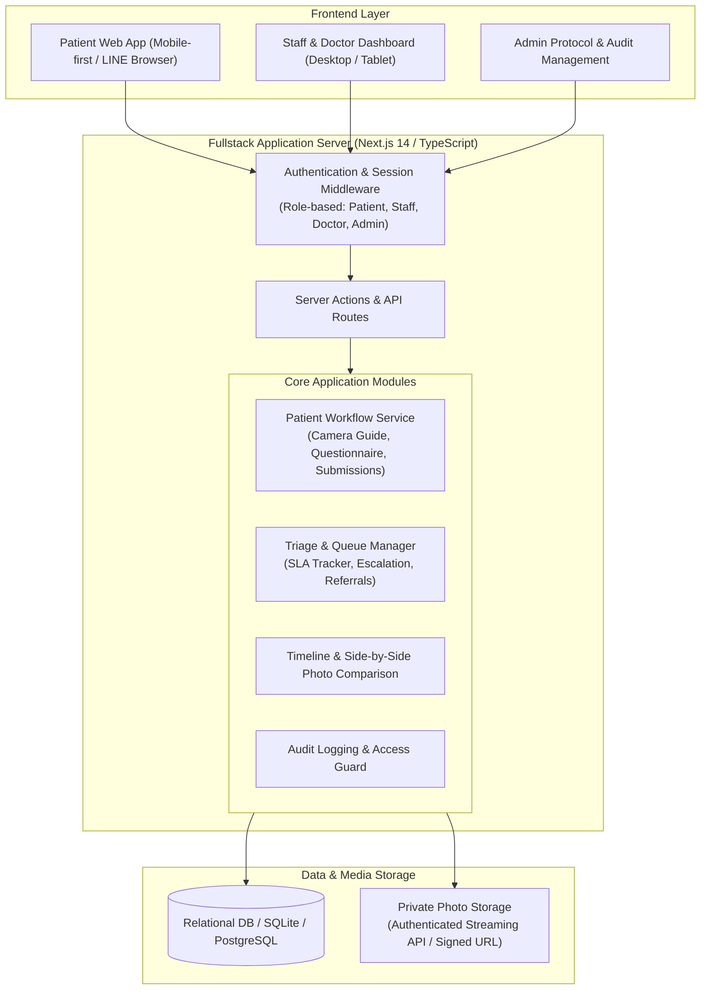
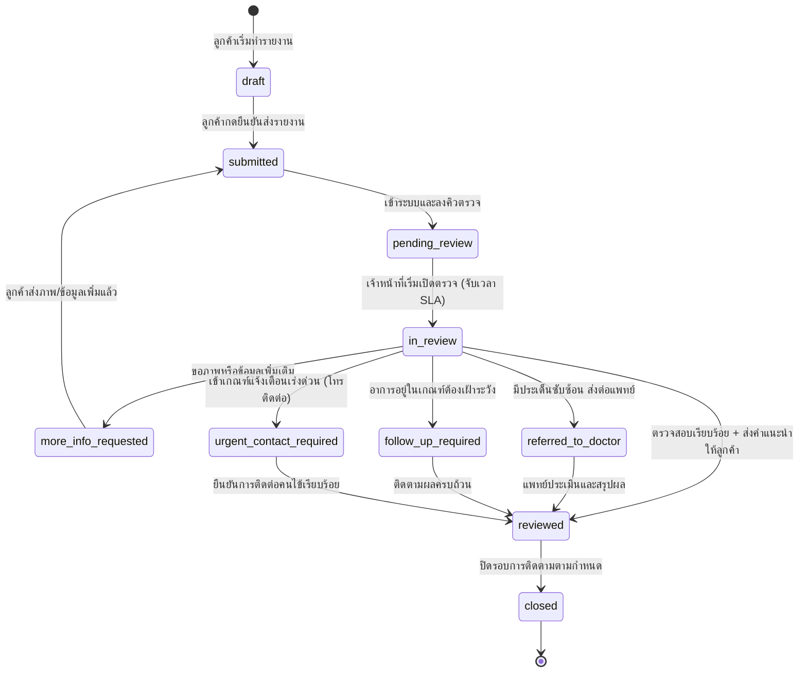

# แผนการพัฒนาระบบ UD Clinic — Post-Operative Face-Lift Monitoring Web App

> เอกสารแผนงานฉบับละเอียด ออกแบบตามข้อกำหนดใน `ud_clinic_postop_monitoring_webapp.md` (PRD v1.0)  
> วันที่จัดทำ: 11 ตุลาคม 2026 | สถานะ: รอการยืนยันทางเลือกและเริ่มพัฒนา Phase 1

---

## 1. บทนำและสรุปความเข้าใจในระบบ (Executive Summary)

ระบบ **UD Clinic Post-Operative Face-Lift Monitoring Web App** เป็นแพลตฟอร์มการติดตามผลและฟื้นตัวหลังการผ่าตัดดึงหน้า (Face-lift) ที่เชื่อมต่อระหว่าง **ลูกค้า (Patient)** ผ่าน LINE OA เข้ากับ **ทีมดูแล (Care Staff)** และ **แพทย์ (Doctor)** ของคลินิก 

### กฎเหล็กทางการแพทย์และความปลอดภัย (Clinical & Safety Principles)
1. **ไม่ใช่ระบบวินิจฉัยโรค (No Automated Medical Diagnosis):** ห้ามใช้ AI หรือ Logic อัตโนมัติสรุปผลว่าคนไข้ "ปกติ" หรือ "ปลอดภัย" ทุกรายงานต้องผ่านการตรวจคัดกรองโดยมนุษย์ (Human Review)
2. **ไม่ใช่ช่องทางฉุกเฉิน (No Emergency Dependency):** ต้องแสดงคำชี้แจงและเบอร์ติดต่อสายด่วนชัดเจนในทุกขั้นตอนสำคัญ เพื่อไม่ให้ลูกค้ารอคำตอบในระบบเมื่อมีภาวะฉุกเฉิน
3. **ความเป็นส่วนตัวและสิทธิ์เข้าถึง (Privacy by Design):** ภาพใบหน้าคนไข้เป็นข้อมูลสุขภาพที่มีความอ่อนไหวสูง (PDPA) ห้ามเก็บภาพใน Public URL หรือส่งในแชท LINE ทั่วไป ต้องจัดเก็บใน Private Storage และเปิดดูผ่าน Authenticated Signed Access เท่านั้น
4. **แยกบันทึกภายในออกจากข้อความถึงลูกค้าอย่างเด็ดขาด:** Internal Notes ของทีมแพทย์/เจ้าหน้าที่จะต้องถูกแยกออกจาก Customer Message เพื่อป้องกันข้อมูลภายในรั่วไหล
5. **ดีไซน์ตามอัตลักษณ์คลินิก (Clinic Brand Identity):** คลีน เรียบ โปร่ง น่าเชื่อถือ ใช้โทนขาว/เทาอ่อน และน้ำเงิน Navy Blue ของ UD Clinic **ไม่ใส่ Emoji ใน UI หลัก** (ใช้ไอคอนเวกเตอร์ทางการแพทย์ที่ได้มาตรฐาน เช่น Lucide Icons)

---

## 2. โครงสร้างสถาปัตยกรรมระบบ (System Architecture)



### แนะนำเทคโนโลยีที่เหมาะสม (Recommended Stack):
- **Framework:** Next.js 14+ (App Router, TypeScript) — รองรับ Server Components, Server-side validation, และ API routes ในโปรเจกต์เดียว สะดวกในการรัน Local และ Deploy
- **Styling:** Tailwind CSS + Vanilla CSS tokens ตาม Color Palette ของ UD Clinic (Royal Navy `#0B2545`, Classic Blue `#134074`, Slate `#64748B`, Light Neutral `#F8FAFC`)
- **Iconography:** `lucide-react` (ไอคอนมาตรฐาน ไม่ใช้ Emoji ใน UI หลัก)
- **Data Layer:** SQLite / Prisma หรือ In-Memory/File Repository พร้อม Typed Schema เพื่อให้รันได้ทันทีโดยไม่ต้อง setup external server ยุ่งยาก
- **Photo Handling:** HTML5 Canvas + MediaDevices API สำหรับ Camera capture พร้อม Overlay Silhouette Guide และ Fallback file picker ที่รองรับ Mobile Safari & Chrome ใน LINE Browser
- **Security:** Session-based token / Signed URL pattern สำหรับดึงภาพ ป้องกัน Direct Object Reference (IDOR)

---

## 3. ผังสถานะรายงาน (Report Status State Machine)

ตามข้อกำหนด PRD ส่วนที่ 11 ต้องแยกสถานะ **"ส่งแล้ว" (Submitted)** ออกจาก **"ตรวจแล้ว" (Reviewed)** อย่างชัดเจน:



---

## 4. รายละเอียดหน้าจอและการทำงาน (Screens & Key Features)

### 4.1 ฝั่งคนไข้ (Patient Web App — Mobile First)

| หน้าจอ | องค์ประกอบหลักและการทำงาน |
| :--- | :--- |
| **1. Access & Verification** | - จำลองการเข้าจาก LINE OA หรือ Secure Invite Link<br/>- ยืนยันตัวตนด้วย OTP หรือ Quick Select เพื่อทดสอบในโหมด Demo<br/>- ผูกเข้ากับ Case ผ่าตัดดึงหน้าของตนเองโดยตรง |
| **2. Privacy Notice & Consent** | - แสดงข้อความแจ้งการประมวลผลข้อมูลส่วนบุคคลและข้อมูลสุขภาพ (PDPA)<br/>- บันทึก Consent Timestamp และ Version |
| **3. Patient Home (Overview)** | - สรุปข้อมูลเคส: วันที่ผ่าตัด, จำนวนวันหลังผ่าตัด (D+1, D+3, D+7 ฯลฯ)<br/>- แถบเตือน: "ไม่ใช่ช่องทางฉุกเฉิน หากมีอาการผิดปกติรุนแรง โทร 0xx-xxx-xxxx"<br/>- สถานะรายงานวันนี้: ยังไม่เริ่ม / ส่งแล้ว (รอตรวจ) / ขอข้อมูลเพิ่ม / ตรวจแล้ว<br/>- ปุ่ม Action หลักเพียงปุ่มเดียวตามสถานะ (เช่น "เริ่มรายงานประจำวัน") |
| **4. Guided Photo Capture Wizard** | - ระบบนำถ่ายภาพ 5 มุมมาตรฐานตามโปรโตคอล Face-lift:<br/>  1) หน้าตรง (Front View)<br/>  2) มุมเฉียงซ้าย 45° (Left Oblique)<br/>  3) มุมเฉียงขวา 45° (Right Oblique)<br/>  4) ด้านข้างซ้าย 90° (Left Profile)<br/>  5) ด้านข้างขวา 90° (Right Profile)<br/>- มีกรอบจัดตำแหน่งใบหน้า (Silhouette Overlay Guide)<br/>- คำแนะนำเรื่องแสง ระยะกล้อง และการเก็บผมให้เห็นกรอบหน้าและแผลผ่าตัด<br/>- Preview ภาพทันที พร้อมปุ่ม "ถ่ายใหม่" หรือ "ใช้ภาพนี้"<br/>- Fallback file uploader สำหรับเครื่องที่ไม่รองรับ direct camera access |
| **5. Symptom Questionnaire** | - แบบสอบถามอาการมาตรฐาน:<br/>  • ระดับความปวด (NRS Score 0-10 พร้อมคำอธิบายระดับ)<br/>  • อาการบวมเมื่อเทียบกับเมื่อวาน (ลดลง / เท่าเดิม / บวมมากขึ้น)<br/>  • การซึมของเลือดหรือน้ำเหลืองบริเวณแผล (ไม่มี / ซึมเล็กน้อย / ซึมมากต่อเนื่อง)<br/>  • มีไข้หรือหนาวสั่น (ไม่มี / รู้สึกรุมๆ / วัดไข้ได้ > 37.8°C)<br/>  • อาการชา ตึง หรือความรู้สึกผิดปกติบริเวณใบหน้า<br/>  • ช่องพิมพ์ข้อความหรือข้อกังวลเพิ่มเติมถึงทีมดูแล |
| **6. Review & Submit** | - สรุปภาพทั้ง 5 มุม และคำตอบทั้งหมดในหน้าเดียว<br/>- สามารถกดแก้ไขแต่ละจุดได้<br/>- ปุ่มกดยืนยันส่งรายงาน พร้อมป้องกัน Double-click submission |
| **7. Submission Confirmation** | - แสดงหมายเลขเลขอ้างอิงรายงาน (Report Ref ID) และ Timestamp<br/>- ข้อความชัดเจน: "ส่งรายงานสำเร็จ — รอทีมดูแลตรวจสอบ"<br/>- แสดงเบอร์ติดต่อฉุกเฉินของคลินิกอย่างเด่นชัด |
| **8. Follow-up & Messages** | - ลูกค้าเปิดดูข้อความและคำแนะนำที่ทีมดูแลส่งกลับมาได้<br/>- หากมีการขอข้อมูลเพิ่ม (More Info Requested) จะมีปุ่มพาไปถ่ายมุมที่ต้องการส่งเพิ่ม |

---

### 4.2 ฝั่งเจ้าหน้าที่และแพทย์ (Staff & Doctor Dashboard — Desktop/Tablet)

| หน้าจอ | องค์ประกอบหลักและการทำงาน |
| :--- | :--- |
| **1. Overview & Triage Queue** | - Metric Cards: รายงานใหม่วันนี้, ค้างตรวจเกิน SLA (> 2 ชม.), เคสส่งต่อแพทย์, เคสที่ต้องติดตามเร่งด่วน<br/>- ตารางคิวรายงาน (Queue Table) แยกแท็บตามสถานะ พร้อม Filter/Search ตามชื่อคนไข้, วันที่ D+, หรือแพทย์เจ้าของไข้<br/>- Urgent Flag แสดงเด่นชัดหากคนไข้รายงานอาการบวมเฉียบพลันหรือเลือดออกมาก |
| **2. Case Detail & Clinical Review** | - ข้อมูลคนไข้, ข้อมูลการผ่าตัด (วันผ่าตัด, ศัลยแพทย์ผู้ผ่าตัด, ชนิดการดึงหน้า)<br/>- Timeline แสดงความคืบหน้ารายวัน (D+1, D+2, D+3, D+5, D+7, D+14)<br/>- **ระบบเปรียบเทียบภาพ (Side-by-Side Compare):** เปรียบเทียบภาพมุมเดียวกันระหว่างวัน (เช่น หน้าตรง D+1 เทียบกับ D+7) พร้อมเครื่องมือซูม/ตรวจสอบความผิดปกติของแผล<br/>- แสดงคำตอบแบบสอบถามอาการประจำวันและประวัติย้อนหลัง |
| **3. Review Action Panel** | - **Action เลือกได้ตามสิทธิ์:**<br/>  • บันทึกว่าตรวจแล้ว (Reviewed)<br/>  • ขอภาพหรือข้อมูลเพิ่มเติม (Request More Info) พร้อมระบุว่าต้องการมุมไหน<br/>  • ส่งต่อแพทย์ (Refer to Doctor) พร้อมระบุข้อสังเกตและเหตุผล<br/>  • ทำเครื่องหมายติดตามเร่งด่วน (Urgent Follow-up Required)<br/>- **การแยกฟิลด์ข้อความ (Strict Separation):**<br/>  • *Internal Clinical Notes:* บันทึกภายในคลินิก (คนไข้ไม่เห็นเด็ดขาด)<br/>  • *Customer Message:* คำแนะนำที่ส่งให้คนไข้เห็นในแอป |
| **4. Protocol & Settings (Admin)** | - ปรับแต่งมุมภาพที่ต้องถ่ายตามระยะวันหลังผ่าตัด (เช่น D+1-3 ถ่าย 5 มุม, D+14 ถ่าย 3 มุม)<br/>- กำหนดคำถามในแบบสอบถาม<br/>- จัดการผู้ใช้งานและสิทธิ์ (Admin, Doctor, Care Staff) |
| **5. Audit Trail & Activity Log** | - ตรวจสอบย้อนหลัง: ใครเป็นผู้เปิดดูภาพคนไข้, ใครเปลี่ยนสถานะ, เวลาใด, IP/User Agent เพื่อความโปร่งใสตามมาตรฐาน PDPA |

---

## 5. แผนการดำเนินงานเป็นระยะ (Phase-by-Phase Roadmap)

### Phase 1: Foundation, Data Models & Shell (รากฐานระบบ)
- ติดตั้ง Project (Next.js 14 App Router, TypeScript, Tailwind CSS, Lucide Icons)
- ออกแบบ Data Schema และ Seed ข้อมูลจำลอง (Mock Data) คนไข้ 4-5 รายในระยะฟื้นตัวที่แตกต่างกัน (D+1, D+3, D+5, D+7, D+14) พร้อมรูปภาพตัวอย่างและรายงานย้อนหลัง
- สร้างระบบ Demo Switcher ด้านบน (Navbar) ให้สลับมุมมองระหว่าง **"มุมมองลูกค้า (Mobile View)"**, **"Care Staff"**, **"แพทย์"**, และ **"Admin"** ได้ทันทีเพื่อความสะดวกในการทดสอบทุก User Journey
- วาง Layout และ Design System สไตล์คลินิก (โทนสะอาด ขาว/น้ำเงิน ปราศจาก Emoji)

### Phase 2: Patient Mobile Experience (การส่งรายงานของคนไข้)
- หน้า Patient Home แสดงสถานะเคส, วัน D+N, และข้อความเตือนความปลอดภัย
- Guided Camera Capture: ถ่ายภาพ 5 มุม พร้อม Silhouette Overlay และ Fallback Uploader
- Symptom Questionnaire แบบมี Validation ชัดเจน
- หน้ารวม Review & Submit พร้อม Modal ยืนยัน
- หน้า Submission Confirmation แสดง Ref Code และสถานะรอการตรวจ
- หน้า View Approved Feedback & Request More Info

### Phase 3: Staff & Doctor Review Dashboard (การตรวจและติดตามของเจ้าหน้าที่)
- คิวรายงาน (Report Queue) พร้อมตัวกรองสถานะ, SLA Tracker, และ Urgent Badge
- Case Detail View: ข้อมูลคนไข้, อาการประจำวัน, ประวัติรายงานย้อนหลัง
- **Side-by-side Photo Timeline Comparison** เปรียบเทียบมุมภาพเดียวกันระหว่างวันหลังผ่าตัด
- Action Box: ส่งต่อแพทย์, ขอข้อมูลเพิ่ม, บันทึกผลตรวจ
- การแยกช่องกรอก Internal Note และ Customer Message
- Activity Log แสดงประวัติการดำเนินการ

### Phase 4: Admin, Protocol Settings & Security Hardening
- หน้าจัดการ Protocol มุมภาพและแบบสอบถามตามช่วงวัน
- ระบบ Audit Log บันทึกประวัติการเปิดดูและแก้ไข
- API ตรวจสอบสิทธิ์และระบบจัดเก็บภาพแบบ Private Access
- การจัดการ Error states: กล้องไม่รองรับ, ออฟไลน์, เซสชันหมดอายุ

### Phase 5: Verification & Polish
- ทดสอบ End-to-End User Flow: คนไข้ส่ง -> เจ้าหน้าที่รับเรื่อง -> แพทย์ตรวจ -> ส่งกลับคนไข้
- ตรวจสอบความถูกต้องตาม Acceptance Criteria ใน PRD
- จัดเตรียมเอกสาร README และ Environment setup

---

## 6. โครงสร้างไฟล์และโฟลเดอร์ของโปรเจกต์ (Project Structure)

```text
ud-clinic-postop/
├── src/
│   ├── app/
│   │   ├── layout.tsx                # App layout, Fonts, Global styles
│   │   ├── page.tsx                  # Landing / Demo Mode Selector
│   │   ├── patient/                  # Patient Mobile-first Web App
│   │   │   ├── page.tsx              # Patient Home / Overview
│   │   │   ├── consent/page.tsx      # Privacy Notice & Consent
│   │   │   ├── report/               # Daily Report Wizard
│   │   │   │   ├── page.tsx          # Step controller
│   │   │   │   ├── capture/          # Guided Camera Capture (5 angles)
│   │   │   │   ├── symptoms/         # Questionnaire form
│   │   │   │   ├── review/           # Review all data
│   │   │   │   └── success/          # Submission confirmation
│   │   │   └── history/page.tsx      # Past reports & feedback
│   │   ├── staff/                    # Staff & Doctor Dashboard
│   │   │   ├── layout.tsx            # Staff layout with sidebar & header
│   │   │   ├── page.tsx              # Triage Queue & Metrics Overview
│   │   │   ├── cases/[id]/page.tsx   # Case Detail & Side-by-side Photo Compare
│   │   │   └── audit/page.tsx        # Audit Trail & Activity Logs
│   │   ├── admin/
│   │   │   └── protocols/page.tsx    # Reporting Protocol Settings
│   │   └── api/                      # Backend API / Image Streaming
│   │       ├── reports/              # Report CRUD & Actions
│   │       ├── cases/                # Case endpoints
│   │       └── photos/[id]/          # Secure private photo streaming endpoint
│   ├── components/
│   │   ├── common/                   # Buttons, Badges, Modals, DemoBar
│   │   ├── patient/                  # CameraGuide, SilhouetteOverlay, SymptomForm
│   │   └── staff/                    # QueueTable, PhotoCompare, ReviewActionModal
│   ├── lib/
│   │   ├── mock-data.ts              # Synthetic Thai post-op cases & history
│   │   ├── types.ts                  # TypeScript definitions matching PRD Section 12
│   │   ├── store.ts                  # Reactive state management for prototype
│   │   └── utils.ts                  # Helpers for Thai dates, D+ calculation, formatting
│   └── styles/
│       └── globals.css               # Clinic design tokens & reset
├── public/
│   └── placeholders/                 # Clinic guide silhouettes & mock medical photos
├── README.md                         # Setup & architecture guide
└── package.json
```

---

## 7. ข้อมูลตัวอย่างสำหรับจำลองระบบ (Synthetic Mock Data)

เพื่อการทดสอบที่สมจริง จะเตรียมข้อมูลคนไข้หลังผ่าตัดดึงหน้า (Face-lift) 4 เคส:
1. **คุณวรรณา สุขสมบูรณ์ (เคส D+1):** ผ่าตัดเมื่อวาน มีอาการบวมและตึงตามปกติ ส่งรายงานแล้ว สถานะ `pending_review` รอนางพยาบาลตรวจ
2. **คุณกมลพร จิตต์อารี (เคส D+3):** รายงานว่าแผลซึมเล็กน้อยและระดับปวด 4/10 มี Urgent Flag แสดงเด่นชัด ส่งต่อสถานะ `referred_to_doctor`
3. **คุณพัชรี เลิศวานิช (เคส D+7):** นัดตัดไหมและติดตามอาการ ส่งภาพครบ ตรวจแล้ว สถานะ `reviewed` ได้รับคำแนะนำการประคบอุ่น
4. **คุณศิริพร บุญญาพาณิชย์ (เคส D+14):** อาการบวมยุบ 80% เจ้าหน้าที่ขอข้อมูลภาพมุมด้านข้างเพิ่ม สถานะ `more_info_requested`
